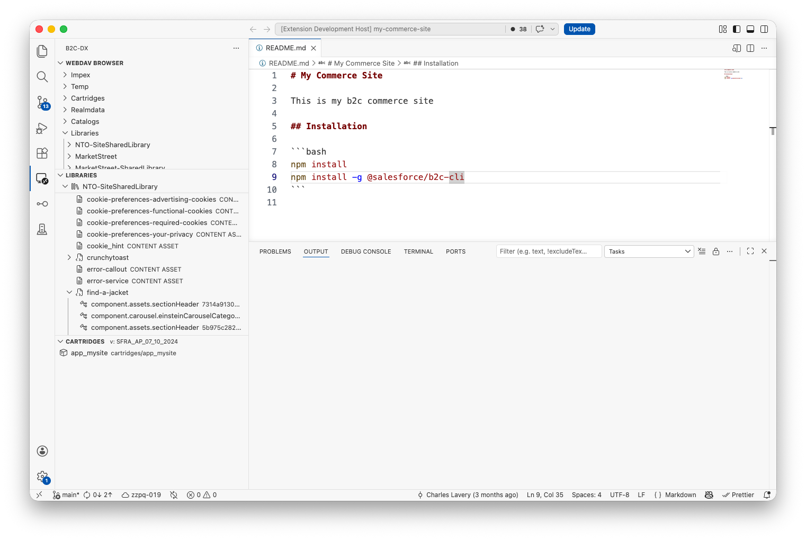
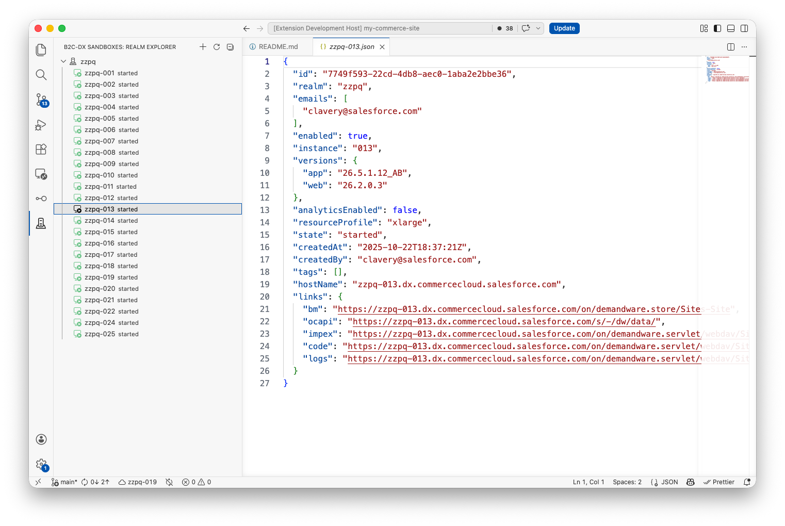
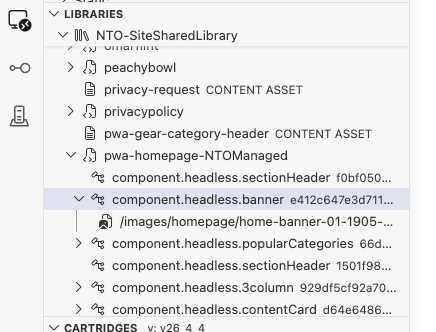

# B2C Commerce IDE Extension

Build and debug B2C Commerce projects in **VS Code, Cursor, and other VS Code-compatible editors** with the official extension published by Salesforce. Manage sandboxes, sync cartridges, browse content libraries and SCAPI schemas, debug server-side scripts, and scaffold new projects from your editor. If your project already works with the [B2C CLI](../cli/overview), the extension picks up the same connection automatically.

Available on the [Visual Studio Marketplace](https://marketplace.visualstudio.com/items?itemName=Salesforce.b2c-vs-extension) and [Open VSX Registry](https://open-vsx.org/extension/salesforce/b2c-vs-extension). See [installation](./installation) for your editor.

## Highlights

### ISML and Script API Editor Support

Write storefront code with ISML syntax highlighting, snippets, formatting, tag completion, diagnostics, and Emmet support. Cartridge JavaScript files automatically provide autocomplete and hover documentation for `dw/*` modules without writing a `jsconfig.json` into your project, and legacy `.ds` scripts under `cartridge/scripts/` are treated as JavaScript so they get the same support. See the [Script API IntelliSense guide](../guide/ide-integration#script-api-intellisense) for more detail.

### B2C Script Debugger

Step through anything that runs server-side: cartridge controllers, jobs, custom scripts, SCAPI hooks, and Custom APIs. Set breakpoints, drop log points, watch variables, and step in and out — the full debugger experience you'd expect from any other Node project.

### Scaffolding

Generate new cartridges, controllers, hooks, jobs, and other boilerplate from a curated set of templates. Available from **File → New File...** or by right-clicking a folder in the Explorer.

### Sandbox Realm Explorer

Spin up, start, stop, clone, and clean up your on-demand sandboxes from a tree view. Cloned sandboxes are clearly marked, and the right-click menu only shows actions that make sense for the sandbox's current state. From the Command Palette, **Start/Stop/Restart Sandbox** targets the active status-bar instance (OAuth + ODS sandbox hostname required).

### Library Explorer

Find Page Designer pages and components fast, with one-click export (with assets, without assets, or assets only), live editing of component XML, and round-trip imports of site archives. The library tree is filterable when you have hundreds of pages.

**Content blocks** (reusable, shared `fragment.*` content) get a dedicated **Content Blocks** group under each library — the single source of truth where a block and its full child tree live. Wherever a page or component links a block, it appears as a reference (↗) that reveals the canonical block in the group when clicked, so a shared block is only ever edited in one place. (Converting a component into a content block is done in Business Manager / Page Designer.)

### Site Archive Export

Build site archive exports interactively from the **Export** view. Select site,
global, catalog, inventory, assignment, and composable storefront data units,
then download and extract the generated archive. Storefront exports are selected
by storefront name and limited to one storefront per export, matching the B2C
Commerce platform contract.

### Cartridge Management and Code Watch/Upload

Edit cartridges locally and have changes show up on your sandbox automatically. Deploy on demand, diff against the active code version, and manage code versions without leaving the editor.

Code sync needs only your instance hostname: start it, paste the hostname when asked, and sign in with your Account Manager account. See [Code sync with only a server](./configuration#code-sync-with-only-a-server).

The **Cartridges** view lists cartridges in cartridge path order, which IntelliSense and ISML template links follow. The order comes from the order you set in the view (drag and drop), your `cartridges` configuration, or a site's cartridge path on your instance, in that order. See [cartridge order](../guide/ide-integration#script-api-intellisense).

### Endpoints

The **Endpoints** view shows what your cartridges expose and what runs for each request, using the same cartridge order as the **Cartridges** view:

- **Controllers**: every SFRA and SiteGenesis controller endpoint (`Cart-AddProduct`) with the methods it accepts and whether it requires HTTPS, a logged-in customer, and a CSRF token. Expand an SFRA endpoint to see the middleware and handlers that run, in order and with the cartridge each comes from, and the `server.get`/`post`/`append`/`prepend`/`replace` statements across cartridges that built it. Endpoints that accept POST without a CSRF check, or whose `server.replace()` dropped security middleware, are marked with a warning.
- **Custom APIs**: each API's endpoints with method, path, security scheme, and scopes from `schema.yaml`, linked to the implementing function. Missing operations, missing `.public = true`, and APIs defined in more than one cartridge are flagged.
- **Hooks**: each extension point's registrations in cartridge path order. For system extension points (`dw.*`, including OCAPI/SCAPI hooks), an implementation that returns a value skips the later registrations and the system implementation, so the view flags implementations that can return one. Custom extension points run every registration.

Click any row to open the code. Use **Filter** to narrow by name and **Show Only Endpoints with Issues** to focus on warnings. The **Cartridges** view also lists each cartridge's controllers and the route statements in each file, noting when another cartridge replaces, prepends to, or appends to a route. Turn the view off with the `b2c-dx.features.endpoints` setting.

### SCAPI API Explorer

Explore every SCAPI API your instance exposes and try requests against them in a built-in Swagger UI. Authentication is handled for you using the same credentials your CLI already has.

### Object Types

Browse system object types (Product, Order, Customer, and others), their custom and system attributes, and attribute groups in the **B2C-DX: APIs** sidebar. Expand an enum attribute to see its values, copy an attribute's ID (the plain form scripts use, such as `myAttribute`; the tooltip shows the `c_` form used in OCAPI and SCAPI), open its full definition, or export an object type as metadata XML. **Write Custom Attribute Types to Project** in the view toolbar adds the attributes to Script API IntelliSense.

To change a custom attribute, open its definition, edit the JSON, and save. The extension compares your edit with the instance and asks you to confirm before it changes anything. Properties such as the display name, flags, and lengths are updated through the Object Definitions API. Enum values and default values, which that API cannot set, are imported with a site import that runs the site archive import job. That needs the instance hostname and WebDAV and job access. Values you leave out of the list are kept. Remove values in Business Manager. The value type and attribute ID cannot be changed. System attributes open read-only.

Right-click an object type, or its **Custom Attributes** folder, and choose **New Custom Attribute...** to create one. Pick an ID, a value type, and a display name, then confirm. The new definition opens so you can set more properties and save.

To manage the values of a custom enum attribute without editing JSON, right-click it and choose **Add Value...**, or right-click one of its values and choose **Edit Display Value...**, **Set as Default Value**, or **Remove Value...**. Each change asks for confirmation and runs a site import. Display value edits change the default locale and keep other translations. A removed value is no longer offered in Business Manager; objects that already use it keep it stored.

Viewing needs an Account Manager API client with the `sfcc.object-definitions` scope. Showing enum values and making changes need `sfcc.object-definitions.rw`. Nothing is requested until you select **Load Object Types**, and access problems are shown in the view. Hide it with the `b2c-dx.features.objectTypesExplorer` setting.

### WebDAV Browser

Browse your sandbox's catalogs, libraries, and IMPEX folders right inside your editor. Open remote files like local ones, drag-and-drop to upload, or mount a remote folder as a workspace folder.

### Log Tailing

Stream live `error-*.log`, `warn-*.log`, and `info-*.log` files from your sandbox into your editor's output panel. Use **Start Tailing Logs** to begin and **Stop Tailing Logs** to end. The prefix picker also lists the custom logger files (`custom-*.log`) found on the instance, plus `custom-` to tail all of them.

### Active Instance Status Bar

The bottom-left of the window shows your active instance — the name, the hostname, and a pin icon if you've locked a particular folder as the project root. Click it to switch instances; every view updates instantly. Palette **Start/Stop/Restart Sandbox** commands use this active instance.

### B2C CLI Plugin Support

The extension runs the [B2C CLI](../cli/overview) under the hood, so any plugin you've installed via `b2c plugins install` automatically applies here too. Add a plugin that introduces a new config source, a custom sandbox command, or middleware, and the extension picks it up the next time the workspace loads — no separate plugin registry. See [CLI extensions](../guide/third-party-plugins) for available integrations.

## Next Steps

- [Installation](./installation) — download and install the extension.
- [Connecting to your sandbox](./configuration#connecting-to-a-b2c-instance) — what each feature needs.
